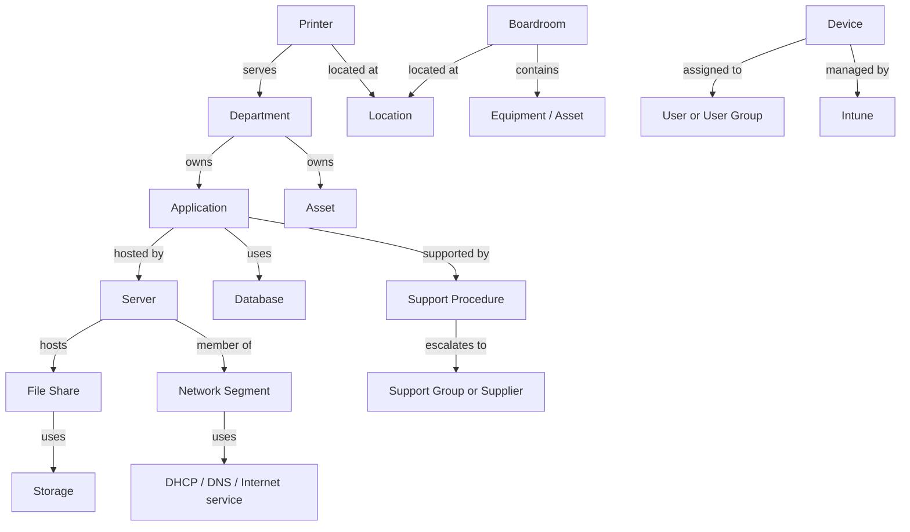
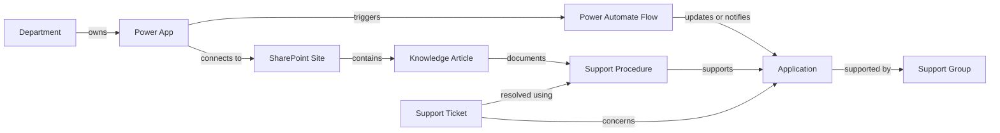

# AEGIS Environment Knowledge Model

**Status:** Proposed organizational knowledge framework  
**Version:** MVP / pre-1.0  
**Audience:** IT operations, service desk, knowledge owners, engineering, security, and future AEGIS agents  
**Scope:** One organization; MVP Knowledge Agent and Helpdesk Agent  
**Related decisions:** Approved AEGIS Architecture Decision Records, MVP Functional Specification, and Security Model

> **Scope note:** This is an organizational intelligence and knowledge-governance model, not a technical architecture or a claim that particular systems, connectors, or data sources are already deployed. The source inventory, role descriptions, quality targets, and example records below are proposed defaults for organizational approval. Examples are fictional and must not be interpreted as facts about the AEGIS organization.

## 1 Executive Summary

### Purpose of the Environment Knowledge Model

The Environment Knowledge Model defines how AEGIS represents and reasons about the organization-specific facts needed to support IT operations. It establishes:

- The kinds of operational entities AEGIS should understand.
- How entities relate to one another across departments, services, locations, and processes.
- Which sources may establish or corroborate facts, who owns those sources, and how trustworthy they are.
- How knowledge is created, reviewed, published, refreshed, accessed, and retired.
- How AEGIS finds and returns knowledge with provenance, access controls, confidence, and freshness.
- Measurable standards for knowledge quality and operational usefulness.

Organizational knowledge matters because useful IT support depends on local facts: which server hosts an application, which team owns it, where a printer is located, who supports a Power App, and which procedure is current. Such facts change over time and often exist across records and documents. Without owners, relationships, provenance, and review, a plausible answer can still be wrong or expose information to the wrong user.

### AI intelligence and environment intelligence

- **AI model intelligence** is general language capability: interpreting questions, summarizing supplied context, and generating responses. It does not inherently know the organization's current assets, ownership, network, procedures, or access rules.
- **Environment intelligence** is the governed, sourced, access-controlled, time-aware knowledge about this specific organization and its operational environment.

AI models answer general questions. **AEGIS must answer organization-specific questions using approved organizational evidence.** The model may help interpret and explain evidence, but it is not itself a source of truth. If evidence is missing, conflicting, stale, or inaccessible, AEGIS should say so, show the sources it can disclose, and ask for clarification or recommend an appropriate support path rather than inventing a fact.

## 2 Knowledge Domains

Domains organize related knowledge for ownership, permissions, search, reporting, and agent use. An entity may participate in more than one domain. Each domain must have accountable owners and access rules.

| Domain | Knowledge included | Typical questions |
|---|---|---|
| **Infrastructure** | Servers, virtual machines, storage, file shares, network devices, DHCP scopes, DNS zones/records, internet connections, hosting and service dependencies. | Where is a file share hosted? Which server hosts this application? Which network segment serves this location? |
| **End User Computing** | Laptops, desktops, mobile devices, managed/Intune devices, assigned or shared equipment, device standards, lifecycle and support eligibility. | Which device is assigned to a user? Is this device within the supported standard? |
| **Applications** | Business applications, Power Apps, Power Automate flows, custom systems, SaaS platforms, technical dependencies, support ownership, criticality and approved use. | Which Power App handles Courier Requests? Who owns this system? What does it depend on? |
| **Collaboration** | SharePoint sites, Teams channels, knowledge bases, internal documentation, content owners, access groups and canonical links. | Where is the current procedure? Which site contains the Finance operating guidance? |
| **Operational Processes** | Ticket categories, support procedures, escalation paths, incident response, change management, service hours and support boundaries. | What is the VPN troubleshooting procedure? Who should receive this issue next? |
| **Physical Resources** | Boardrooms, printers, offices/locations, IT storerooms, meeting equipment and physical-to-digital relationships. | Which boardrooms have Teams devices? Which printer belongs to Finance? |
| **Security** | Security tools, monitoring systems, access control systems, security procedures, ownership and reporting/escalation paths. | Which system monitors this service? How should a suspected security incident be reported? |

### Domain boundaries

- The domains describe knowledge, not an unrestricted data collection mandate. Collect only approved information needed for operational questions.
- Identity, security, and infrastructure details may be sensitive. Apply source and object access policy before retrieval and before content is passed to an agent.
- A fact that appears in more than one domain has one authoritative owner/source where possible. Other records should link to it or be explicitly marked as corroborating evidence.
- The MVP focuses on approved knowledge sources and supported Helpdesk workflows. Broad integrations with device, network, ticketing, or security platforms are future candidates, not implied MVP functionality.

## 3 Knowledge Entity Framework

An entity represents a thing, group, place, process, or record that AEGIS can refer to consistently. Each entity should have a stable identifier, a human-readable name, provenance, lifecycle status, and relationships. Fields are a proposed common vocabulary; fields containing sensitive data require explicit classification and access rules. Not every field is required for every record.

| Entity | Purpose | Core fields | Typical relationships | Fictional example |
|---|---|---|---|---|
| **Server** | Represent a physical or virtual compute host relevant to an application or service. | `server_id`, hostname, environment, platform/type, status, location/hosting zone, owner department, technical owner, criticality, source, last verified. Avoid storing secrets or unnecessary configuration. | Hosts Application, File Share, or Database; belongs to Network Segment and Location; supported by Procedure; owned by Department. | `SRV-APP-042`, production application host, owner: Corporate IT. |
| **Device** | Represent an end-user endpoint or managed mobile device. | `device_id`, asset tag, device name, device type, manufacturer/model, lifecycle status, assigned user/group where permitted, management state, standard profile, last inventory time, source. | Assigned to User or User Group; managed by Intune; located at Location; supported by Procedure; belongs to Department. | `DEV-01824`, laptop, managed, assigned to a fictional Finance employee. |
| **Printer** | Represent a shared or departmental print resource and its support details. | `printer_id`, display name, model, asset tag, location, network address/reference if classified, supported functions, status, owner department, support group, source, last verified. | Located at Location; serves Department or User Group; connected to Network Segment; supported by Procedure; associated with Asset. | `PRN-FIN-02`, Finance floor printer, status operational. |
| **Boardroom** | Represent a bookable meeting room and its support-relevant equipment. | `boardroom_id`, room name, site/building/floor, capacity, booking reference, accessibility notes, equipment summary, support contact, status, source, last verified. | Located at Location; contains Equipment/Device; uses Application or Collaboration service; supported by Procedure. | `ROOM-ORCHID`, fictional 10-seat room with Teams-certified meeting equipment. |
| **Application** | Represent a business or technical application as an operational service. | `application_id`, canonical name, description/purpose, service tier/criticality, lifecycle status, business owner, technical owner, department, support group, vendor, data classification, dependencies, source, review date. | Owned by Department; hosted by Server or SaaS Supplier; uses Database; supported by Procedures; used by User Groups; related to Power Apps/Flows. | `APP-COURIER`, internal courier request service, owner: fictional Logistics Operations. |
| **Power App** | Represent a Power Platform application and its purpose, owner, audience, and dependencies. | `power_app_id`, display name, environment, app type, purpose, business owner, technical owner, audience/security group, data classification, connected sources, lifecycle status, source, last verified. | Owned by Department; connects to SharePoint Site or Application; used by User Group; may trigger Power Automate Flow; supported by Procedure. | `PAPP-COURIER`, fictional app for submitting courier requests. |
| **Power Automate Flow** | Represent an automated process, its trigger, owner, dependencies, and operational consequence. | `flow_id`, display name, purpose, environment, trigger summary, owner, run/support contact, connected systems, data classification, impact tier, status, last reviewed. Never store credentials or tokens. | Supports Application or Power App; reads/writes SharePoint Site or other systems; owned by Department; supported by Procedure. | `FLOW-COURIER-NOTIFY`, fictional notification flow started by a courier request. |
| **Department** | Represent an organizational unit responsible for services, resources, or knowledge. | `department_id`, canonical name, aliases, parent department, service owner/contact role, business hours, approved support route, source, effective dates. Avoid personal contact details unless approved. | Owns Application, Asset, Knowledge Article, or Process; uses User Groups; has Locations; escalates to Department or Support Group. | `DEPT-FIN`, fictional Finance department and its approved service contact role. |
| **SharePoint Site** | Represent a collaboration/content site as a governed knowledge source. | `site_id`, canonical name, URL/reference, purpose, owner department, site owners, audience/access groups, classification, source-of-truth designation, lifecycle status, review date. | Contains Knowledge Articles/Documents; owned by Department; accessible to User Groups; supports Application or Procedure. | `SITE-IT-KB`, fictional IT knowledge site with a designated content owner. |
| **Knowledge Article** | Represent a controlled, user-facing or technician-facing answer with provenance and review status. | `article_id`, title, purpose, content/reference, topic, audience, owner, reviewer, source, classification, status, version, created/modified/review dates, expiry/review date, tags. | Published in SharePoint Site or Knowledge Base; documents Application, Device, Procedure, or Incident; owned by Department; supersedes/is superseded by another article. | `KA-VPN-001`, fictional approved VPN troubleshooting article. |
| **Support Procedure** | Represent ordered operational guidance for diagnosis, resolution, escalation, or recovery. | `procedure_id`, name, scope, symptoms/trigger, prerequisites, steps or canonical reference, expected outcome, stop conditions, escalation path, owner, approver, classification, version, status, review date. | Supports Application, Device, Network Segment, or Ticket Category; owned by Department; linked to Knowledge Article; escalates to Support Group/Supplier. | `PROC-VPN-RESET`, fictional procedure for supported VPN connection failures. |
| **Network Segment** | Represent an operationally meaningful network boundary, without exposing unnecessary sensitive topology. | `segment_id`, name, purpose, location, approved address/range reference where access permits, VLAN/zone reference, environment, owner, security classification, DNS/DHCP references, source, last verified. | Contains or serves Devices, Servers, and Printers; uses DHCP and DNS services; belongs to Location; governed by Security Procedure. | `NET-HQ-USER`, fictional headquarters user segment. |
| **Support Ticket** | Represent a support case and its operational classification/relationship to services. A ticket reference may be indexed without copying all content. | `ticket_id`, ticket-system reference, category, summary, status, priority, created/updated dates, requester/department where permitted, assigned group, linked service/assets, resolution reference, classification. | Concerns Application, Device, Printer, or Incident; follows Procedure; assigned to User Group/Support Group; may reveal a Knowledge Article candidate. | `TCK-10482`, fictional VPN issue linked to `PROC-VPN-RESET`. |
| **User Group** | Represent an access, support, or business group without treating group membership as proof of resource authorization unless policy says so. | `group_id`, canonical name, group type, purpose, authoritative source, owner, membership rule/reference, access scope, review date, status. Do not copy membership unless necessary and approved. | Owns/supports Applications or Procedures; grants access to SharePoint Site; assigned Tickets; associated with Department. | `GRP-HELPDESK-L1`, fictional first-line support group. |
| **Supplier** | Represent an external vendor or managed service provider responsible for a product/service. | `supplier_id`, canonical name, service/product, contract/support reference, service owner, support route, service hours, data handling classification, renewal/review dates, status. Avoid credentials and confidential contract details unless permitted. | Supplies Application, Server, or Network Service; supports Procedure or Escalation Path; may process organizational data. | `SUP-NETWORK`, fictional network service supplier record. |
| **Asset** | Represent a tracked physical or logical item with lifecycle, assignment, and ownership. | `asset_id`, asset tag/serial reference, asset type, model, lifecycle state, acquisition/warranty references, owner department, custodian/reference, location, source, last inventory date. Restrict serial/person-linked details as required. | Realized as Device, Printer, Server, or Equipment; assigned to Department/User Group; located at Location; supplied by Supplier; supported by Procedure. | `AST-90021`, fictional room display asset in `ROOM-ORCHID`. |

### Supporting entities

The following entities make the requested relationships unambiguous. They are supporting vocabulary, not substitutes for the primary entities above.

| Entity | Purpose | Core fields | Typical relationships | Fictional example |
|---|---|---|---|---|
| **File Share** | Represent a logical shared storage resource independently of the server that hosts it. | `share_id`, canonical name, purpose, hosting reference, owner, audience/access reference, classification, lifecycle status, source, last verified. Do not expose paths or permissions beyond the user's access. | Hosted by Server or Storage; owned by Department; accessible to User Group; supported by Procedure. | `SHARE-OPS`, fictional Operations shared files service. |
| **Storage** | Represent a storage service or platform that hosts logical file shares or application data. | `storage_id`, canonical name, service type, purpose, owner, location/hosting reference, classification, status, source, last verified. Avoid credentials and sensitive configuration. | Hosts File Share or Database; used by Application; owned by Department or Supplier; supported by Procedure. | `STOR-OPS-01`, fictional shared storage service. |
| **Database** | Represent an application data service without storing credentials or unrestricted connection details. | `database_id`, service name, purpose, environment, owning application, technical owner, hosting/service reference, classification, status, source, review date. | Used by Application; hosted by Server or Supplier; supported by Procedure; classified and access-controlled. | `DB-COURIER-PROD`, fictional application database service. |
| **Location** | Represent an approved physical place or logical hosting location. | `location_id`, canonical name, location type, parent location, address/reference if permitted, timezone, owner, classification, status, source. | Contains Boardroom, Printer, Device, Server or IT Storeroom; belongs to Department or site. | `LOC-HQ-A`, fictional headquarters building. |
| **Equipment** | Represent room or shared-use equipment that is not best represented as an end-user Device. | `equipment_id`, name, type, asset reference, status, support owner, location/room, source, last verified. | Located in Boardroom or Location; linked to Asset; supported by Procedure; may use Application or Network Segment. | `EQ-ROOM-DISPLAY-21`, fictional boardroom display. |
| **Support Group** | Represent a team responsible for a service queue or escalation route. | `support_group_id`, canonical name, scope, owner department, service hours, queue/reference, escalation target, source, review date. | Supports Application, Procedure, Ticket Category, or Supplier escalation; receives Support Ticket. | `GRP-NETWORK-OPS`, fictional network operations group. |
| **Incident** | Represent a time-bounded service disruption or security/operational event and its approved references. | `incident_id`, source reference, category, affected service, severity/priority, start/end, status, owner, classification, related procedure, source. Limit sensitive incident details. | Affects Application, Network Segment, or Location; follows Incident Response Process; may generate Support Tickets and Knowledge Articles. | `INC-2026-014`, fictional service incident reference. |
| **Ticket Category** | Represent a controlled classification used to route and report support requests. | `category_id`, name, description, eligibility, priority guidance, assigned group, related services/procedures, status, source, owner. | Routes Support Ticket to Support Group; associated with Application, Device, or Procedure. | `CAT-VPN`, fictional VPN support category. |
| **Network Service** | Represent DHCP, DNS, internet connectivity, or another shared network service at a useful operational level. | `network_service_id`, name/type, purpose, service owner, affected locations/segments, supplier, status, source, freshness, classification. Detailed configuration is restricted. | Serves Network Segment, Location, Server, or Application; supplied by Supplier; supported by Procedure. | `NS-DNS-HQ`, fictional DNS service reference. |
| **User** | Refer to a person only when needed for an approved operational relationship, such as a device assignment or support request. | Stable source reference, display name or approved alias, department/group reference, relationship purpose, source, classification, and permitted visibility. Avoid personal attributes and copied identity profiles. | Member of User Group; assigned Device or Asset; requester/assignee on Support Ticket where permitted. | Fictional user reference `USR-0142`, with no real identity data. |

### Common field rules

- IDs are stable and never reused; human-readable names and aliases may change.
- Record system-of-record identifiers and source links instead of copying a full source record when a reference is sufficient.
- Use controlled values for status, classification, domain, environment, and confidence. Document allowed values in the organizational data dictionary.
- Dates include time zone/UTC normalization where timestamps are used. Distinguish source modification time from AEGIS ingestion time and last human verification.
- Record uncertainty and unknown values explicitly. Do not fill missing facts with model-generated guesses.
- Personal data, exact network details, security configuration, ticket narrative, or user-group membership require need-to-know access and approved handling.

## 4 Organizational Relationship Model

AEGIS should represent explicit, sourced relationships rather than infer them solely from name similarity. Relationships should be directional where useful, typed from a controlled vocabulary, attributable to a source, and valid for an effective period. A relationship may carry confidence and visibility separate from the entities it connects.

### Core relationship examples

- Department **owns** Application, Asset, or Knowledge Article.
- Application **uses** Database, **is hosted by** Server, and **is supported by** Support Procedure or User Group.
- Server **hosts** Application or File Share and **belongs to** Network Segment and Location.
- Boardroom **contains** Equipment and **is located at** Location.
- Printer **belongs to / is located at** Location and **serves** Department or User Group.
- Power App **connects to** SharePoint Site and **triggers** Power Automate Flow.
- Support Procedure **supports** Application, Device, Ticket Category, or Incident and **escalates to** Support Group/Supplier.
- User Group **supports** Application or Procedure and **has access to** a SharePoint Site when an authoritative access relationship exists.
- Support Ticket **concerns** an Application, Device, or Service and **was resolved using** a Procedure or Knowledge Article when the source supports that conclusion.

### Relationship diagram: operational environment



### Relationship diagram: Power Platform and knowledge



Diagrams show example relationship types, not mandatory or currently populated links. Ingestion must preserve the evidence for each edge. If two sources disagree about an owner or host, AEGIS must surface the conflict rather than silently choose a relationship.

## 5 Knowledge Source Inventory

Sources are candidates for organizational knowledge, not an assumption that all may be ingested. Source access, data classification, owner, licensing, privacy, and purpose must be approved before indexing. A source connector is not authorized to bypass source ACLs. The security model's per-user visibility requirement applies to structured facts, documents, embeddings, citations, and cached results.

**Trust level** refers to the source authority defined in Section 6, not whether the connector itself is technically secure. **Update frequency** is a proposed target to be agreed with the owner and source capability.

### Structured sources

| Source | Typical facts | Trust level | Ownership | Proposed update frequency | Ingestion method |
|---|---|---|---|---|---|
| SharePoint Lists | Service/application registers, owners, locations, procedures index, equipment inventory. | Level 1 only when explicitly designated and controlled as a system of record; otherwise Level 2. | List business owner and SharePoint site owner. | Daily or on change for operational registers; review cadence at least quarterly. | Approved Graph/API connector or controlled export; preserve list item ID, version, ACL and timestamps. |
| SQL Databases | CMDB, asset register, application/service catalogue, or ticket metadata if designated authoritative. | Level 1 for the specific fields and records formally designated authoritative. | Database/service owner and data steward. | Daily or event-driven where supported; freshness SLA by dataset. | Read-only, scoped views/API; least-privilege identity; schema and field allowlist; no arbitrary query access by agent. |
| Asset Registers | Asset ID, type, lifecycle, assignment, location, warranty and owner. | Level 1 if formally maintained as the authoritative asset register. | Asset management owner. | Daily/weekly synchronization depending on source; inventory reconciliation at approved interval. | Approved export or API; retain source key, last inventory timestamp, and deletion/retirement status. |
| Intune | Managed device inventory, compliance/management state, configuration/profile references. | Level 1 for facts Intune owns, such as managed device state; not necessarily business ownership or local service desk notes. | Endpoint management owner. | Daily or API delta sync; respect source freshness and user/device ACL policy. | Approved API integration (future candidate); read-only scopes; minimize user identifiers; filter before agent access. |
| Entra ID | User/group identity references, group metadata, application registrations/roles where approved. | Level 1 for identity facts Entra owns; group membership is not automatically application authorization. | Identity and access management owner. | On change or periodic delta; revoke stale cached access promptly. | Approved Graph/identity integration (future candidate); least-privilege read scopes; do not ingest credentials or unnecessary membership data. |
| N-able | Managed device/service monitoring status and operational inventory where licensed and approved. | Level 1 for tool-owned monitoring facts; Level 2 for curated operational interpretation. | Monitoring/service owner. | Near-real-time or periodic sync as needed; document API freshness. | Approved API or export (future candidate); scoped read-only integration; retain event time and source reference. |

### Semi-structured sources

| Source | Typical facts | Trust level | Ownership | Proposed update frequency | Ingestion method |
|---|---|---|---|---|---|
| SharePoint Libraries | Approved procedures, service documentation, diagrams, policies, and reference documents. | Level 2 by default; Level 1 only when designated as the official record for a fact/policy. | Library/site owner and named document owner. | On change or scheduled daily/weekly sync; honor deletions and ACL changes. | Approved synchronization or controlled document upload; preserve version, URL, ACL, classification, and review state. |
| Word Documents | Runbooks, SOPs, design/ownership records. | Level 2 if approved and current; otherwise lower until reviewed. | Named authoring department and content owner. | On publication/change; review by the document's defined review date. | Parse approved library copy; retain document identity and version; do not ingest personal-drive documents by default. |
| PDFs | Policies, vendor guides, topology/service documents, approved manuals. | Level 2 when approved by an owner; externally sourced guidance requires validation. | Document owner or relevant service owner. | On replacement and scheduled review; monitor source status. | Controlled upload or approved repository sync with text extraction and page/section provenance. |
| SOPs | Step-by-step operational procedures, support boundaries, rollback and escalation instructions. | Level 2 after review and publication; Level 1 only if designated policy source. | Process owner and approver. | Review at least annually or after a material process/system change; shorter for high-risk procedures. | Controlled publication workflow; versioned source and explicit approval status. |
| Knowledge Articles | End-user/technician guidance, troubleshooting, known errors and FAQs. | Level 2 when approved and in date. | Knowledge owner and reviewer. | Review by expiry date; operational articles reviewed at least annually or on incident/process change. | Knowledge platform/API or controlled upload; preserve audience, ACL, status, version and citations. |

### Unstructured sources

| Source | Typical facts | Trust level | Ownership | Proposed update frequency | Ingestion method |
|---|---|---|---|---|---|
| Emails | Decisions, service changes, incident coordination, informal ownership information. | Level 4 by default; may be elevated only after a responsible owner verifies and republishes the fact. | Mailbox/data owner and relevant service owner. | Not continuously ingested by default; curate only durable, approved facts. | Manual curation into an approved article/register; no broad mailbox ingestion in MVP. |
| Teams Conversations | Troubleshooting discussion, announcements, informal decisions and support hints. | Level 4 by default; conversation content is not authoritative without review. | Team/site owner and responsible process owner. | Curate approved outcomes when they become durable; no blanket chat ingestion in MVP. | Manual review/curation or narrowly approved future Graph integration with retention and ACL policy. |
| Ticket Notes | Symptoms, troubleshooting performed, resolution and service patterns. | Level 3 when authored by a technician; ticket status/assignment may be Level 1 if the ticketing platform owns it. | Ticket owner, service desk manager, and service owner. | Event-driven or periodic only after privacy/ACL filtering; curate repeatable solutions. | Scoped API/export; redact personal or sensitive content; promote validated resolution to approved procedure/article. |
| Historical Documentation | Old diagrams, retired service notes, migration records and legacy procedures. | Level 3 or Level 4 until currency and ownership are verified; archived evidence may remain useful with clear dates. | Historical record owner and current service owner. | Review during migration or query-driven refresh; archive when superseded. | Controlled import marked historical/superseded; never rank as current without verification. |

### MVP source boundary

The MVP supports knowledge from approved sources that can be manually curated or ingested through an explicitly approved first source. This inventory does not make Graph, Intune, N-able, Teams, Power Platform, ticketing, or arbitrary databases committed MVP integrations. Before any source is enabled, assign a source owner, define ACL semantics, approve fields and classification, test deletion/update propagation, and document the expected freshness.

## 6 Knowledge Trust Model

Trust levels indicate how much authority a source may have for a particular fact. They are not blanket ratings for entire systems. A system can be authoritative for its own fields and only corroborative for other claims. Access permission is separate from trust: high-trust information must still be withheld from users lacking access.

| Level | Name | Definition | Typical examples | Default use |
|---|---|---|---|---|
| **Level 1** | Official System of Record | A formally designated source maintained by an accountable owner for a specific data domain/field, with controlled changes and identifiable records. | Approved asset register for asset lifecycle; Entra for identity object state; designated service catalogue for application ownership. | Prefer for the fields it owns when current and accessible. |
| **Level 2** | Approved Documentation | Versioned and reviewed documentation published by an owner, with approval/status and a review date. | Current SOP, approved knowledge article, signed-off service runbook. | Primary procedural evidence and corroboration for Level 1 facts. |
| **Level 3** | Technician Notes | Operational observations or ticket notes from an identifiable technician, not yet promoted into a controlled record. | Recent incident note, troubleshooting observation, service desk resolution. | Useful supporting evidence; qualify as observational and seek confirmation for consequential decisions. |
| **Level 4** | User-Generated Knowledge | Informal conversations, unreviewed content, user suggestions, or inferred statements without an approved owner. | Email statement, Teams post, draft note, model-generated hypothesis. | Discovery lead only. Do not present as confirmed fact or use as authority for action. |

### Conflict resolution and answer policy

When sources conflict, AEGIS should:

1. Compare facts about the same entity, field, scope, and effective period; distinguish a legitimate change over time from a true conflict.
2. Verify that each source is accessible to the requesting user and that its record is current, published, and not superseded.
3. Prefer the designated Level 1 source for fields it owns, followed by approved Level 2 documentation. Do not let a higher-level source override a field it does not own.
4. Consider effective date and freshness within the source's expected update interval. A stale Level 1 record may require qualification or owner confirmation rather than automatic precedence.
5. Use Level 3/4 evidence only as corroboration or a lead for human review, never to silently override a current authoritative record.
6. If material conflict remains, state that records disagree, cite the accessible sources and their dates/trust levels, and recommend the named owner or support route. Do not blend incompatible values into a single confident answer.
7. Never disclose a restricted source's existence or content if the user lacks permission, unless policy explicitly permits a safe generic access-denied message.

Confidence is a calibrated assessment of evidence for a particular answer, not a model's feeling. It should reflect source authority, recency, agreement, completeness, provenance, and access filtering. Unknown confidence is preferable to false precision.

## 7 Knowledge Lifecycle

| Stage | Required activity | Accountable responsibilities |
|---|---|---|
| **Creation** | Identify a user or operational need; create a record/article with a clear purpose, owner, source, classification, and intended audience. Link it to existing entities rather than duplicating facts. | Contributor drafts; Knowledge Owner is accountable for the domain record. |
| **Review** | Check accuracy against source of truth, completeness, clarity, access scope, privacy/security classification, dependencies, and operational safety. Confirm procedures with the responsible service team. | Reviewer checks content and permissions; subject-matter/service owner verifies facts. |
| **Approval** | Approve publication according to risk. High-impact security, recovery, access, or production-change procedures require designated owner/approver sign-off and possibly Security/change approval. | Authorized Knowledge Owner/process approver. Author cannot approve alone where separation of duties is required. |
| **Publication** | Publish an approved version to an approved source, set status and effective/review dates, preserve source link/version, and make it discoverable only to its authorized audience. | Knowledge Administrator or source owner publishes; AEGIS ingestion records provenance and visibility. |
| **Maintenance** | Revalidate on material system/process changes, source changes, incidents, user feedback, or scheduled review. Update relationships, version and review date; invalidate stale derived content. | Knowledge Owner maintains accuracy; Administrator monitors overdue records and synchronization. |
| **Archiving** | Mark superseded/retired content; preserve only when operational or legal value justifies it. Remove it from current-answer ranking and clearly label historical status/effective period. | Owner approves retirement; Administrator ensures search does not present it as current. |
| **Deletion** | Delete or de-index content when the source is removed, retention expires, or an authorized request requires deletion. Propagate deletion to chunks, embeddings, caches, and derived copies subject to approved backup/legal-hold policy. | Data/source owner authorizes; Administrator executes and records deletion; Security/Privacy advises when required. |

Every lifecycle transition must be attributable and versioned. AEGIS should distinguish **draft**, **pending review**, **approved**, **published**, **under review**, **superseded**, **archived**, and **deleted** states. Draft, rejected, expired, or archived content must not be used as current operational guidance unless a user explicitly requests historical context and has permission.

## 8 Environment Metadata Standards

Every knowledge object must carry the core metadata needed to determine what it means, who owns it, whether it is current, whether it is safe to show, and how it relates to other objects. Where a field is not applicable, record “not applicable”; do not invent a value.

### Required core metadata

| Metadata | Meaning and standard |
|---|---|
| **Object ID** | Stable unique AEGIS/source identifier; do not reuse after retirement. |
| **Canonical name** | Preferred display name; aliases are separate searchable values. |
| **Purpose / description** | Concise explanation of the object's operational role. |
| **Domain and object type** | Controlled domain/type values from the Section 2/3 vocabulary. |
| **Owner** | Accountable business/service or knowledge owner role/group, with a durable source reference. Avoid unapproved personal details. |
| **Department** | Owning or responsible department where applicable; distinguish owner from user/customer. |
| **Source system and source record** | Source name, stable record key, source URL/reference, and whether it is authoritative for the stated fields. |
| **Classification** | Organization-approved data classification and handling constraints; required before publication. |
| **Access scope** | Source ACL/reference and effective audience/visibility. Access must be enforced before retrieval, not merely described in metadata. |
| **Created date / modified date** | Source creation and last modification times when available; retain the timezone/source semantics. |
| **Ingested date** | When AEGIS last captured the record; distinct from source modification time. |
| **Last verified / review date** | Last human or authoritative-system confirmation and next review/expiry date. |
| **Status and version** | Lifecycle status and source/version identity; indicate supersession where relevant. |
| **Confidence / trust level** | Evidence-based confidence and source trust level, with the factors or provenance supporting it. |
| **Tags and aliases** | Controlled search terms, common names, abbreviations, and historical aliases. Avoid uncontrolled sensitive terms. |
| **Relationships** | Typed links to related entity IDs, with source, effective dates, and confidence where known. |
| **Location / environment** | Physical location, logical environment (e.g. production/test), or applicability scope as appropriate and permitted. |

### Why metadata matters

Metadata enables access filtering, source ranking, conflict resolution, freshness detection, ownership routing, deletion propagation, relationship discovery, and defensible citations. Without it, semantic similarity can return a plausible but unauthorized, outdated, or contextually wrong document. Metadata is operational information and must itself be protected where it reveals sensitive infrastructure or access patterns.

## 9 Search and Retrieval Model

Retrieval should answer the user's intent with the smallest set of relevant, accessible, current evidence. Search must not return content merely because it is semantically similar.

1. **Interpret the question:** Identify likely intent, entity names/aliases, domain, requested relationship, timeframe, and whether the user requests procedure, ownership, status, or location. Ask a clarifying question when the entity or scope is ambiguous.
2. **Apply authorization first:** Resolve the authenticated principal's permitted sources, records, fields, and groups. Filter before content or embeddings are exposed to the agent. Do not use ranking or citations to bypass access checks.
3. **Metadata filtering:** Narrow by entity type, department, environment, location, status, effective date, classification, and source ACL where applicable. Exclude drafts, deleted records, and superseded material from normal current answers.
4. **Keyword search:** Match exact identifiers, hostnames, asset tags, room names, acronyms, application titles, and procedure codes. Keyword matching is important for precise operational lookups.
5. **Semantic search:** Find conceptually relevant approved text when the user describes a problem differently from the source wording. Semantic similarity is a candidate-generation technique, not proof of truth or authorization.
6. **Hybrid search:** Combine exact/lexical matches with semantic candidates. Re-rank using source trust, ownership, access, lifecycle status, recency, and evidence agreement. Tune with representative organizational questions rather than generic benchmarks alone.
7. **Source priority ranking:** Prefer the designated system of record for fields it owns; then approved current documentation; then attributed technician notes; then user-generated material as an explicitly lower-confidence lead.
8. **Recency weighting:** Compare modified/verified time with the source-specific freshness expectation and effective period. Newer is not automatically more authoritative; stale data must be marked and qualified.
9. **Confidence weighting:** Raise confidence when independent, current sources agree on the same scoped fact; lower it for missing ownership, conflict, stale content, weak trust, or incomplete relationships. Do not double-count copied documents as independent evidence.
10. **Answer and provenance:** State the answer, relevant scope, source title/reference, source date/version, and any uncertainty or conflict. Cite only records the user may access. For a multi-hop answer, preserve provenance for each relationship edge.
11. **No evidence / failure:** Say when no authorized source was found, when access is insufficient, or when sources conflict. Do not fabricate facts, citations, or relationships. Recommend an owner, procedure, or escalation path only when sourced.

Redis may cache reconstructible search results only with keys scoped to relevant access context and short, defined TTLs. Permission changes, source changes, and deletions must invalidate or safely expire cached results; cache presence never overrides authorization.

## 10 Knowledge Ingestion Framework

Ingestion is a governed publication process, not bulk copying. Each source must have an approved purpose, owner, access mapping, classification, allowed fields, update/deletion behavior, and quality checks before it is connected.

### Ingestion methods

- **Manual entry:** A contributor creates or corrects a structured entity or article using an approved template. Require owner, source/provenance, classification, status, review date, and relationships before publication.
- **Document upload:** Accept only from approved users and locations. Check type/size, extract text with page/section references, preserve original version and ACL, and route through review before content becomes trusted/current.
- **SharePoint synchronization:** Future connector candidate. Sync only approved sites/libraries; preserve item version, ACL/group visibility, owner, URL and deletion status; handle changed permissions and deleted documents.
- **Database synchronization:** Use an approved read-only API/view with field allowlist and stable keys. Do not expose arbitrary SQL or database credentials to agents. Check schema/version changes and source freshness.
- **API integrations:** Use individually approved, scoped integration identities and operations. Validate response schema, source timestamps, pagination, rate limits, and error states. An API error must not be interpreted as an empty authoritative dataset.
- **Scheduled imports:** Define schedule by source volatility and business need. Record last successful sync, coverage, failed records, and lag. Alert owners when freshness exceeds the approved SLA.

### Change detection and version tracking

1. Identify records by stable source key and compare source version/modified timestamp plus a content fingerprint where appropriate.
2. Treat additions, modifications, ACL changes, withdrawals, and deletions as distinct events.
3. Preserve a new version and provenance; do not silently overwrite an approved version or erase evidence of a prior publication.
4. Reapply classification and access controls on every update. An ACL change can require immediate search/index invalidation even if text is unchanged.
5. Remove or disable deleted/revoked content from retrieval and clear dependent caches within the source's approved deletion SLA.
6. Track sync watermark, successful and failed counts, rejected records, and last complete refresh. Partial failure must be visible and should not make stale data appear freshly confirmed.
7. Store embedding model/version metadata for vectorized content. Re-embedding is a controlled re-indexing activity that must preserve source permissions, provenance, and lifecycle status.
8. Record human corrections with actor, reason, and source references. If an authoritative sync later conflicts, surface it to the owner rather than allowing an unreviewed manual override to persist silently.

The MVP can begin with manually curated content and one approved initial source. Integration breadth should expand only when there is a named owner and tested governance path.

## 11 Knowledge Quality Framework

Quality measures should be calculated for a defined population and reporting period. A record is not high quality merely because it is well written or has a high embedding score.

| Dimension | Measurement | Proposed MVP target |
|---|---|---|
| **Accuracy** | Sampled factual fields and procedure steps match the designated source or owner verification; track material corrections and incorrect-answer reports. | At least 95% of sampled high-priority records match their authoritative source; zero known critical unsafe procedure errors left published. |
| **Completeness** | Percentage of active high-priority entities with required identity, owner, source, classification, access, status, and review metadata. | At least 95% of high-priority records complete before release; 100% have an owner, source, classification/access decision, and status. |
| **Consistency** | Conflicting values for the same entity/field/scope across active sources, after excluding valid effective-date differences. | Fewer than 2% unresolved material conflicts in the reviewed high-priority set; all conflicts affecting security, access, or production procedures have an owner and resolution due date. |
| **Freshness** | Active records within their approved review/update interval; source sync lag compared with the agreed SLA. | At least 90% of high-priority records current at launch; 100% of overdue records are flagged and excluded or qualified according to policy. |
| **Ownership** | Active records with a named accountable owner role/group and an available escalation route. | 100% of published records have an owner; unowned content cannot be promoted to Level 1 or 2. |
| **Review frequency** | Percentage of records reviewed by due date, segmented by domain and risk. | 90% of high-priority articles/procedures reviewed by due date; overdue high-risk procedures are visibly flagged and withheld from current guidance pending owner review. |
| **Provenance** | Percentage of answerable published records with an identifiable source record/version and retrieval citation. | 100% of published Level 1/2 facts have traceable provenance; sampled answers identify supporting sources. |
| **Access correctness** | Tests of authorized and unauthorized users against source/object visibility, including changed/revoked permissions. | 100% pass for defined access-control tests; any confirmed cross-scope disclosure is a release blocker. |
| **Retrieval usefulness** | Representative query set measures whether relevant, permitted evidence appears in top results and answers are properly qualified. | Establish a baseline; target at least 90% of reviewed high-priority test questions have an appropriate sourced result or an explicit safe “not found/uncertain” response. |

### Review cadence guidance

Set cadence according to volatility and risk rather than applying one schedule to all records:

- Identity, access scope, security controls, network mappings, and high-impact runbooks: review on change and at least quarterly.
- Application ownership/dependencies, device standards, and support routes: review on change and at least semi-annually.
- General support articles and low-risk location/equipment records: review at least annually or on reported change.
- Historical or archived information: review when reused; clearly label effective period and historical status.

These are proposed targets. Domain owners may set stricter intervals. Any record overdue for review must be flagged; whether it is excluded or returned with a stale warning depends on risk and approved policy.

## 12 Environment-Specific Knowledge Examples

All records below are **fictional examples** showing the intended information shape. They do not describe actual AEGIS infrastructure, departments, addresses, owners, systems, or policies. Production examples must use approved classifications and access scopes.

### File Server

```text
Entity: Server
ID: SRV-FS-021
Name: FS-OPS-01
Purpose: Hosts the approved Operations shared file service.
Environment: Production
Owner department: Corporate IT
Technical owner: Infrastructure Operations group
Location: Primary hosting environment (restricted detail)
Network segment: NET-SRV-01
Relationships:
  - hosts -> File Share: Operations Shared
  - supported by -> Procedure: PROC-FILESHARE-ACCESS
  - escalates to -> User Group: GRP-INFRASTRUCTURE
Source: Fictional approved service register, record SRV-FS-021
Trust: Level 1 for hostname, lifecycle, and hosting relationship
Classification: Internal; exact network details restricted to authorized support staff
Status: Active
Last verified: 2026-09-15
Review date: 2027-03-15
```

An answer to “Where is this file share hosted?” should identify the share-to-server relationship, cite the service register, and avoid returning restricted network detail to an unauthorized user.

### Printer

```text
Entity: Printer
ID: PRN-FIN-02
Name: Finance Floor Printer
Purpose: Shared print service for the fictional Finance department.
Model: Approved office printer model (example only)
Location: Example HQ, Floor 2, Print Area B
Owner department: Finance
Support group: GRP-HELPDESK-L1
Network reference: Restricted; resolve only for authorized support
Relationships:
  - serves -> Department: Finance
  - located at -> Location: Example HQ, Floor 2
  - supported by -> Procedure: PROC-PRINTER-TRIAGE
Source: Fictional approved asset register, record AST-PRN-220
Trust: Level 1 for asset tag/status; Level 2 for user-facing instructions
Classification: Internal
Status: Active
Last inventory: 2026-10-01
```

The answer to “Which printer belongs to Finance?” should resolve the department relationship and distinguish a printer owned by Finance from one merely located nearby.

### Boardroom

```text
Entity: Boardroom
ID: ROOM-ORCHID
Name: Orchid Room
Location: Example HQ, Building A, Floor 3
Capacity: 10
Equipment: Teams-certified room device, display, table microphone
Booking reference: Fictional room booking directory
Support route: GRP-HELPDESK-L1
Relationships:
  - contains -> Asset: AST-ROOM-90021 (room display)
  - contains -> Device: DEV-ROOM-008 (meeting device)
  - located at -> Location: Example HQ, Building A
  - supported by -> Procedure: PROC-TEAMS-ROOM-CHECK
Source: Fictional facilities/meeting-room register
Trust: Level 1 for room/location; Level 2 for setup steps
Classification: Internal
Status: Active
Last verified: 2026-08-20
```

This relationship model supports “What boardrooms have Teams devices?” by joining room equipment relationships and citing the room register. Device identifiers or configuration detail may require narrower permissions.

### Power App

```text
Entity: Power App
ID: PAPP-COURIER
Name: Courier Requests
Purpose: Submit and track internal courier requests.
Business owner: Logistics Operations
Technical owner: Business Applications group
Environment: Production
Audience: Approved staff group GRP-COURIER-USERS
Connected source: SITE-COURIER-REQUESTS
Related flow: FLOW-COURIER-NOTIFY
Support procedure: PROC-COURIER-APP
Source: Fictional approved Power Platform register
Trust: Level 1 for owner/environment; Level 2 for user guidance
Classification: Internal
Status: Active
Last reviewed: 2026-09-01
```

For “Which Power App handles Courier Requests?” AEGIS should return the canonical app name, purpose, current status, owner and approved link if visible, with a citation to the Power Platform register.

### Department

```text
Entity: Department
ID: DEPT-FIN
Name: Finance
Aliases: Finance Operations
Purpose: Owns financial planning, accounting, and reporting processes.
Service contact: Finance service owner role (not a personal address)
Business hours: Defined by the approved service directory
Relationships:
  - owns -> Application: APP-FIN-REPORTING
  - owns -> Printer: PRN-FIN-02
  - uses -> SharePoint Site: SITE-FINANCE
  - escalates to -> User Group: GRP-FINANCE-SUPPORT
Source: Fictional organizational service catalogue
Trust: Level 1 for department name/parent; Level 2 for service routing
Classification: Internal
Status: Active
Review date: 2027-01-15
```

Do not treat “department uses a system” as proof that the department owns or administers it. Store these as separate relationship types.

### SharePoint Site

```text
Entity: SharePoint Site
ID: SITE-IT-KB
Name: IT Knowledge Centre
Purpose: Approved internal IT procedures and user guidance.
Canonical reference: Fictional SharePoint site URL
Owner department: Corporate IT
Site owner: IT Knowledge Owner group
Audience/access: GRP-ALL-STAFF for published user articles;
                 GRP-IT-SUPPORT for restricted technician procedures
Classification: Internal; individual articles may have stricter classification
Source-of-truth designation: Level 2 documentation repository
Relationships:
  - contains -> Knowledge Article: KA-VPN-001
  - contains -> Support Procedure: PROC-PRINTER-TRIAGE
Source: Fictional SharePoint site catalogue
Status: Active
Last ACL review: 2026-09-30
```

Site-level access does not automatically make every item equally visible. Preserve and enforce document-level permissions when they differ.

### Support Procedure

```text
Entity: Support Procedure
ID: PROC-VPN-001
Name: VPN Connection Troubleshooting
Scope: Supported organization-managed endpoints using the approved VPN client.
Trigger: User cannot establish or maintain an approved VPN connection.
Prerequisites: Confirm user/device support eligibility; do not request passwords.
Steps: Refer to the fictional approved IT Knowledge Centre article KA-VPN-001.
Stop conditions: Suspected account compromise, security alert, or repeated failure after approved checks.
Escalation: GRP-HELPDESK-L1 -> GRP-IDENTITY-AND-NETWORK
Owner: Network Services owner role
Approver: Network Operations process approver
Source: Fictional versioned SOP
Trust: Level 2
Classification: Internal; restricted escalation details as configured
Version: 3.1
Status: Published
Last reviewed: 2026-10-10
Next review: 2027-04-10
```

The Knowledge or Helpdesk Agent should summarize only the approved steps, preserve stop conditions, avoid collecting credentials, and recommend escalation when a condition is met.

## 13 Governance Model

Roles below are knowledge-governance responsibilities, not substitutes for the application RBAC roles in the Security Model. One person may perform more than one role for low-risk content where organizational policy permits; high-risk procedures and access-sensitive sources should use independent review/approval.

| Knowledge role | Responsibilities | Cannot do by role alone |
|---|---|---|
| **Knowledge Owner** | Accountable for a domain/source or record set; identifies authoritative fields, classification, audience, retention and review cadence; ensures facts and relationships are maintained; resolves conflicts; approves publication or assigns an approver. | Cannot override access policy, approve their own high-risk content where separation of duties applies, or silently change source-of-truth designation. |
| **Knowledge Contributor** | Drafts or updates records/articles; supplies source links, dates, context, relationships and change rationale; reports stale or incorrect content; follows data-minimization and classification rules. | Cannot publish unreviewed content as Level 1/2 or broaden access without owner approval. |
| **Knowledge Reviewer** | Independently verifies accuracy, clarity, completeness, source authority, permissions, safety, and procedure steps; checks effective dates and relationships; approves, rejects, or requests changes with rationale. | Cannot use review to authorize access to data outside their own review scope; cannot make an unapproved consequential system change. |
| **Knowledge Administrator** | Maintains controlled vocabularies, source registry, metadata standards, ingestion health, lifecycle states, version history, deletion propagation, stale-content reporting, and quality metrics; coordinates access reviews with Security/source owners. | Does not become the business owner of facts by operating the platform; cannot weaken source ACLs or silently raise trust/confidence. |

### Governance operating practices

- Maintain a source and entity ownership register with named accountable roles/groups and escalation paths.
- Review access when a source is connected, its ACL changes, an owner changes, and on a defined periodic cadence.
- Resolve content conflicts through the responsible source/domain owner and preserve the decision's provenance.
- Treat user feedback as a review signal, not automatic publication authority.
- Record approvals, updates, archival, deletion, and trust-level changes with actor, timestamp, reason, and version.
- Review quality metrics regularly and prioritize high-impact stale or incomplete records.
- Keep operational knowledge and personal data to the minimum necessary; consult Security/Privacy for uncertain classification or retention.

## 14 Future Knowledge Expansion

Future integrations can improve coverage but must enter through governance: named business owner, approved purpose, minimal data scope, security and privacy review, permission mapping, source-of-truth designation, update/deletion behavior, quality evaluation, and support runbook. These are candidates, not approved commitments or MVP scope.

| Candidate integration | Potential knowledge value | Conditions before activation |
|---|---|---|
| **Microsoft Graph** | Approved Entra identity/group, SharePoint, Teams, and Microsoft 365 metadata. | Approve scopes and data flows; preserve user/source ACLs; minimize personal and conversation content; no broad mailbox/chat ingestion by default. |
| **Intune** | Managed device inventory, compliance state, profile references and device-to-user relationships. | Endpoint owner approval; limit fields and user data; define freshness, device retirement, and access rules. |
| **N-able** | Managed assets, monitoring status, alerts, and service relationships. | Monitoring owner approval; scope endpoints and sensitive telemetry; distinguish live status from historical observations. |
| **SharePoint** | Lists and approved libraries as registers or knowledge repositories. | Source and site ownership, document/item-level permissions, version/deletion propagation, classification, and canonical record designation. |
| **Teams** | Selected teams/channels, approved knowledge posts, and operational announcements. | Explicit team owner approval and purpose; retain ACL and expiration; curate durable facts; do not treat informal conversation as authoritative. |
| **Power Platform** | Power Apps, flows, environments, owners, connections, dependencies, and lifecycle. | Platform owner approval; avoid secrets/connection credentials; classify flow impact and ownership; identify disabled/deleted assets. |
| **Asset Management Systems** | Asset lifecycle, assignments, warranty, location, and service ownership. | Designate authoritative fields; reconcile duplicates and retired assets; restrict serial and user-linked data. |
| **Security Platforms** | Approved security tools, control ownership, alert escalation, procedures, and selected status signals. | Security-owner approval; segregate sensitive alerts and indicators; never expose detection logic or incident details beyond need-to-know. |
| **Ticketing Systems** | Ticket categories, support assignment, case-to-service relationships, approved resolutions, and trends. | Ticket owner/privacy approval; filter personal and sensitive notes; do not present one-off notes as approved procedures; define retention. |

Before deploying an integration, evaluate the source's APIs, availability, rate limits, licensing, data residency/retention, deletion semantics, outage behavior, and incident contact. Failed or partial synchronization must be visible and must not produce falsely current answers.

## 15 Success Criteria

AEGIS's knowledge capability is successful when it consistently helps authorized users answer organization-specific operational questions with sourced, appropriately qualified information.

### User and reasoning outcomes

- AEGIS can answer representative environment-specific questions such as where a permitted file share is hosted, which printer serves a department, which Power App handles a request, what procedure applies to VPN issues, who owns a system, which rooms contain Teams equipment, and how to escalate.
- AEGIS can identify explicit relationships among departments, applications, infrastructure, devices, locations, procedures, support groups, and suppliers.
- AEGIS provides a source, version/date, and visible uncertainty for material factual claims; multi-hop answers show the provenance for the relevant relationships.
- AEGIS recommends a relevant, current, approved procedure when evidence supports it and honors procedure scope, prerequisites, and stop/escalation conditions.
- When evidence is absent, restricted, stale, or conflicting, AEGIS says so and gives a safe next step rather than inventing an answer.

### Knowledge operations outcomes

- Every published high-priority record has an accountable owner, source, classification/access decision, lifecycle status, and review date.
- Source changes, permission changes, archival, and deletion propagate to searchable content, vector representations, and caches within the approved SLA.
- Owners can identify overdue, incomplete, conflicting, low-confidence, or unowned knowledge and assign corrective work.
- Quality measures in Section 11 are reported for a defined knowledge population, with critical access-control or unsafe-procedure failures treated as blockers.
- New sources can be added through a governed process without treating every connector or data store as trusted by default.

### Strategic outcome

AEGIS may become the primary operational knowledge platform over time, but only when business owners establish it as a governed destination and authoritative references are maintained. The MVP should be judged first on reliable, access-controlled, traceable answers and improved knowledge quality—not on ingestion volume, number of integrations, or confidence-sounding prose.
