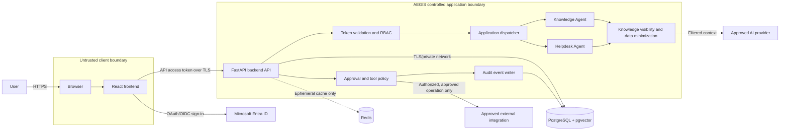
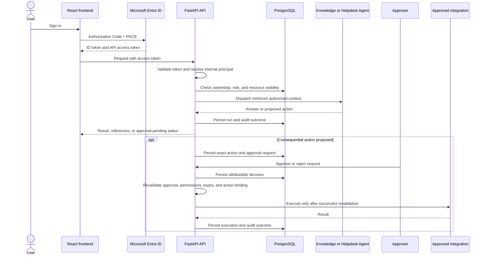

# AEGIS Security Model

**Status:** Proposed security baseline for review and approval  
**Version:** MVP / pre-production  
**Audience:** IT Manager, Solution Architect, Security Team, Technical Review Board, and operations  
**Applies to:** Single-organization AEGIS deployment  
**Architecture basis:** Approved AEGIS Architecture Decision Records (ADRs)

> **Decision status:** The single-organization deployment, modular monolith, FastAPI, React/TypeScript, PostgreSQL with pgvector, Redis as ephemeral cache/coordination, Microsoft Entra ID authentication, two MVP agents, and approval requirement for consequential actions are approved architecture decisions. This document proposes detailed control policies needed to implement those decisions. Role mappings, retention durations, token/session policy, tool tier assignments, and provider/deployment specifics are not settled by the ADRs and require approval by the accountable organization before production.

## 1 Security Overview

### Security goals

AEGIS security controls must:

1. Ensure only authenticated, authorized organizational users and services can use AEGIS resources.
2. Keep conversation, knowledge, approval, and audit data confidential and available only to permitted principals.
3. Ensure users and agents cannot cause consequential changes without an attributable, valid approval for the exact action.
4. Preserve integrity and traceability of identity decisions, agent runs, tool calls, approvals, and administrative changes.
5. Limit the impact of prompt injection, model error, compromised dependencies, stolen credentials, and integration failures.
6. Make failures explicit and fail closed for authentication, authorization, knowledge visibility, approval validation, and consequential execution.
7. Support secure operation, incident investigation, recovery, and controlled change without treating AI output as inherently trusted.

### Security principles

- **Identity first:** Entra authenticates users; the API validates tokens and maps claims to an internal principal. Authentication is not authorization.
- **Least privilege:** Grant only the permissions needed for a role, action, data source, and environment. Use separate human and workload identities.
- **Backend enforcement:** The browser and model are untrusted. Enforce all permissions and policies in the API and integration boundary.
- **Default deny:** Unknown roles, missing claims, stale approvals, unavailable policy checks, and unclassified tools do not grant access or execute actions.
- **Human control of consequential actions:** Models can propose actions but cannot approve them. Re-check approval, actor permissions, and exact action parameters immediately before execution.
- **Data minimization:** Send only the minimum context required to an AI provider or integration. Do not send secrets, bearer tokens, or unnecessary personal or sensitive data.
- **Explicit trust boundaries:** Treat user content, retrieved documents, model output, external systems, packages, and container images as untrusted inputs.
- **Durable accountability:** PostgreSQL is the system of record. Redis is not authoritative for conversations, approvals, or audit history.
- **Defense in depth:** Combine identity, authorization, input/output handling, network controls, database permissions, encryption, monitoring, and recovery.
- **Secure change:** Review and test changes to roles, tools, prompts, knowledge sources, integrations, infrastructure, and dependencies before deployment.

### Threat model assumptions

- AEGIS serves one organization; it does not implement a multi-tenant control plane. Users and resources within that organization still require isolation.
- Users may make mistakes, submit malicious content, or have compromised accounts. Authenticated users are not automatically trusted for all operations.
- AI output can be inaccurate or manipulated. It is not a security decision, approval, or substitute for deterministic policy checks.
- Knowledge documents and external system responses may contain malicious instructions or sensitive data.
- The React application runs on an endpoint outside AEGIS's control. The API, not the browser, is the security enforcement point.
- AI providers, identity services, deployment platforms, and approved integrations are dependencies across trust boundaries. Their contractual, technical, and regional assurances must be reviewed before production use.
- A compromised host, database administrator, identity provider, or deployment control plane can affect AEGIS. This model reduces risk and improves detection and recovery; it does not claim to eliminate those risks.
- Availability targets, formal compliance obligations, data classifications, retention mandates, and recovery objectives have not been set in the ADRs and require organizational decisions.

## 2 Security Architecture

### Components and responsibilities

| Component | Security responsibility |
|---|---|
| User | Uses organizational identity; is responsible for protecting their device and credentials and for reviewing proposed actions before submission. A user cannot elevate their own application role. |
| Browser | Untrusted execution environment. Holds only the state needed for the user experience, obtains an API access token through the approved Entra client flow, and calls the API over TLS. Never contains provider or database secrets. |
| React frontend | Provides sign-in, chat, source references, run status, and approval views. It may hide unavailable actions for usability, but this is not authorization. It must not treat model output, client-supplied role claims, or UI state as authoritative. |
| FastAPI backend | Primary policy enforcement point. Validates access tokens, maps principals, checks RBAC and resource-level access, validates requests, filters knowledge, dispatches to the two approved agents, gates tools, enforces approval state, writes durable records, and emits security events. |
| PostgreSQL + pgvector | Durable system of record for users' internal identity mapping, conversations, messages, runs, approvals, audit events, and knowledge metadata/chunks. Enforces database authentication and permissions; retrieval must apply source visibility filters before content reaches an agent. |
| Redis | Optional reconstructible cache, rate limit, or short-lived coordination only. Use network isolation and authentication/TLS where supported. No authoritative approval, conversation, or audit record may exist only in Redis. |
| AI providers | External trust boundary. Receive only approved, minimized request context. Provider credentials are held server-side. Provider terms, data use/retention, region, model deployment, logging, and incident terms must be approved for the data classification before use. |
| External integrations | Each integration has an explicit owner, allowlisted endpoint and operation set, dedicated least-privilege identity, timeout, output validation, and audit trail. Read operations are still subject to authorization. Consequential operations require approval. |
| Docker runtime and deployment platform | Runs the API and frontend as controlled workloads. Images, build pipelines, runtime identities, network policy, secret injection, patching, and administrative access are part of the production security boundary. |
| Microsoft Entra ID | Organizational identity provider and authorization-claim source. AEGIS validates tokens locally against trusted issuer metadata and approved audiences; it does not trust unvalidated browser claims. |

### Trust boundaries

1. **User device ↔ AEGIS web/API:** Public or organizational network boundary; require TLS, token validation, request validation, rate limiting, and server-side authorization.
2. **Frontend ↔ backend API:** The frontend is a public client and untrusted enforcement layer. API requests are independently authenticated, authorized, and validated.
3. **Backend ↔ PostgreSQL/Redis:** Private service boundary. Permit network access only from required workloads; authenticate services, use least-privilege database roles, and encrypt connections where supported.
4. **Backend ↔ Entra ID:** Identity-provider boundary. Validate issuer, audience, signature, expiry, and required claims; protect server credentials and identity configuration.
5. **Backend ↔ AI provider:** External data-processing boundary. Minimize and classify data, control egress, protect credentials, and approve provider terms and configurations.
6. **Backend ↔ external integrations:** Separate privilege boundary. Scope each service identity and operation; validate returned data as untrusted; record requests and outcomes without logging secrets.
7. **Build/deployment ↔ runtime:** Software supply-chain and administrative boundary. Restrict pipeline permissions, protect signing/secrets, scan artifacts, and require reviewed releases.

### Logical architecture diagram

### Request and action trust flow

## 3 Authentication Model

### Microsoft Entra ID flow

Use Microsoft Entra ID as the sole user identity provider for the MVP. The recommended browser flow is **OpenID Connect (OIDC) Authorization Code Flow with PKCE** using an approved client library and registered application configuration. The frontend is a public client and must not contain a client secret. The backend validates API access tokens; it does not accept an ID token as an API bearer credential.

1. **User login:** The React application redirects the user to the configured Entra authorization endpoint. Entra performs the organization's configured authentication and conditional-access checks.
2. **Token acquisition:** The frontend completes Authorization Code with PKCE and requests an access token for the AEGIS API audience and approved scopes. The ID token is for client sign-in state; the access token authorizes API requests. The client library should use its supported secure token cache and silent renewal behavior.
3. **API token validation:** For every protected request, FastAPI validates signature using trusted Entra signing keys, issuer, audience, expiry/not-before, and required claims. Validate tenant/issuer against the single approved organization configuration. Reject malformed, expired, wrong-audience, wrong-issuer, or insufficient-scope tokens. Map the validated issuer/subject to a stable internal user ID and derive permissions from server-controlled mappings.
4. **Session management:** The API is stateless with respect to user authentication unless a specifically reviewed session feature is introduced. Use short-lived access tokens according to organizational Entra policy. Do not issue a competing AEGIS JWT by default. Keep browser token exposure low; prefer in-memory access-token handling where supported by the selected client architecture. If persistent browser storage or a backend-for-frontend cookie is chosen, document and review the associated XSS/CSRF controls. Apply idle timeout and reauthentication policy through Entra and the approved client configuration.
5. **Refresh tokens:** Refresh tokens are credentials, not session identifiers. In the recommended SPA flow, let the approved Entra client library use Entra's supported renewal mechanism; do not copy refresh tokens into application databases, logs, URLs, or custom browser storage. A backend confidential-client flow, if later introduced, must store credentials/tokens server-side in an approved secret store and define revocation and rotation.
6. **Logout:** The frontend clears local application state and its client-library token cache, then invokes Entra sign-out where configured. Logout should invalidate the local UI session immediately. Revocation of an already-issued access token may not be immediate; keep token lifetimes bounded and use Entra controls for account/session revocation. Do not claim that deleting local state revokes every outstanding token.

### Protocol and token definitions

- **OAuth 2.0** is the delegated authorization framework used to obtain an API access token for specified scopes.
- **OpenID Connect** is the identity layer used for user sign-in and an ID token describing the authenticated identity to the client.
- **Access token** is a bearer credential for a specific API audience and scopes/roles. Treat it as secret. Send it only to the intended API over TLS; never log or pass it to an AI model or tool.
- **Refresh token** can obtain new tokens and therefore has high sensitivity. The browser client library or a specifically approved server-side flow manages it; AEGIS business data stores do not.
- **Internal principal** is the stable AEGIS user identity mapped from validated issuer and subject claims. Role and resource access are assigned by trusted application policy, not from arbitrary client-supplied fields.

Entra application IDs, API audience, scopes/roles, token lifetime, conditional access, and logout behavior are deployment configuration decisions. Security and identity owners must approve them before production.

## 4 Authorization Model

### Proposed RBAC model

RBAC is enforced in FastAPI on every API and tool request. Roles are not assumed to be configured merely because they appear below. The organization must approve Entra group/app-role mappings, role owners, assignment process, and any resource-specific policy before production. A user may hold more than one role only where explicitly approved. Apply resource ownership, knowledge-source visibility, and action policy in addition to role checks.

| Role | Permissions / allowed actions | Restrictions |
|---|---|---|
| **User** | Use chat; create, read, and manage own conversations; submit supported requests; view own run results and source references they are allowed to access; request an eligible consequential action. | Cannot access another user's conversations or restricted knowledge; cannot execute approval-gated actions without a valid approval; cannot approve own requests unless an explicitly approved exception exists (default: prohibited); cannot manage users, roles, tools, or platform configuration. |
| **Helpdesk** | All permitted user actions; access assigned helpdesk queues or cases; view only support data required for assigned duties; perform specifically approved read-only helpdesk operations; review or resolve supported helpdesk requests. | No unrestricted tenant/system administration; no access beyond assigned support scope; cannot bypass tool policy or approval; cannot approve own requests. |
| **Administrator** | Manage application-level settings and operational configuration explicitly delegated to this role; manage approved knowledge-source metadata or user-facing configuration where assigned; review operational state. | No access to secrets by virtue of the role; no unrestricted infrastructure/database administration; cannot alter or erase audit history; sensitive changes require change control; cannot self-approve consequential actions. |
| **Platform Administrator** | Operate deployment/platform configuration, service health, controlled migrations, secret references, backup and recovery processes under privileged access procedures. | Separate privileged identity and just-in-time access recommended; no routine use for chat; no automatic entitlement to read user content or approve business actions; all privileged activity logged and reviewed. |
| **Auditor** | Read audit events, approval history, and configured evidence reports needed for review. Access to conversation/tool payloads only where explicitly authorized and necessary. | Read-only; cannot create or modify users, roles, knowledge, approvals, tools, or operational configuration; sensitive content access is minimized and audited. |

### Authorization rules

- Deny by default. A missing, ambiguous, or stale role assignment is not permission.
- Derive roles from an approved server-side mapping from validated Entra claims or a controlled application assignment process.
- Check both action permission and object/resource scope on every request. Conversation IDs, knowledge references, approval IDs, or tool parameters supplied by a client do not establish ownership.
- Knowledge authorization is applied before retrieval results or chunks are passed to an agent, not only when sources are displayed.
- Check permissions again when an approval is decided and immediately before the action executes; access may have changed since proposal or approval.
- Use separate permissions for proposing, approving, executing, administering, and auditing. Enforce separation of duties for consequential actions.
- Administrative and audit functions use least-privilege service/database identities and produce attributable events.
- Role grants, revocations, and changes are approved, attributable, time-bound where practical, and reviewed periodically.

## 5 Agent Security Model

### Agent operation

The MVP contains only the Knowledge Agent and Helpdesk Agent. The backend dispatcher selects between them using explicit application rules and typed contracts; LangGraph is deferred until Phase 3. Agents execute within the API's controlled application boundary and have no independent user identity, approval authority, or direct unrestricted database/tool credentials.

### Permission inheritance and context

- An agent acts on behalf of the authenticated initiating user for user-scoped operations. It receives no more authority than that user's permissions plus explicitly scoped service capabilities.
- The backend supplies a validated internal principal and policy-filtered context. Do not infer identity or access from conversation text, model output, document instructions, or frontend claims.
- Minimize context to the current task. Do not include unrelated conversations, credentials, full database records, or broad source corpora by default.
- Knowledge retrieval applies source/document access controls before chunks enter the prompt. Citation generation does not relax access controls.
- Treat retrieved documents, user messages, tool outputs, and model-generated arguments as untrusted data. Instructions in those sources cannot override system policy, permissions, or approval requirements.
- Separate trusted policy/configuration from user- and document-provided content. Escape or delimit content as data, and do not let prompts be the sole security control.

### Data access and execution limits

- Agents have no direct ability to grant roles, approve actions, change policies, or call arbitrary URLs/tools.
- Expose a narrow allowlist of reviewed operations with typed parameters, strict validation, bounded result size, timeouts, and rate limits.
- Tool calls execute through backend policy services, not by giving the model credentials.
- Read-only operations still require the initiating user's permission and tool allowlist authorization.
- Any operation classified consequential produces a durable approval request; the agent cannot approve it or execute it directly.
- Bound input size, retrieval count, model output size, execution time, retries, and per-user/request rate. Cancellation and timeout must not be reported as successful execution.
- Validate model output and tool arguments against schemas and business policy. Treat hallucinated facts, citations, identities, or action parameters as untrusted until checked.
- Record agent/run identity, selected agent, relevant policy decisions, source identifiers, tool names, and outcomes without recording secrets or unnecessary prompt content.

## 6 Tool Execution Security

Tool classification is assigned per operation, not per integration brand. A single integration can expose operations at different tiers. The examples below are illustrative and are not an approval to enable those tools. Classify conservatively; an unclassified operation is disabled.

| Tier | Classification and examples | Required permissions | Approval requirements | Audit requirements |
|---|---|---|---|---|
| **Tier 1 - Read Only** | Retrieve an allowed knowledge article, read a permitted helpdesk status, or query a narrowly scoped inventory record. No state change, notification, or external side effect. | Authenticated user; relevant role and resource-level permission; operation allowlisted and input validated. | No separate human approval when the operation is verified read-only and policy-authorized. User request and policy still apply. | Record actor, operation, resource reference, time, outcome, and correlation ID. Avoid logging sensitive returned payloads. |
| **Tier 2 - Low Risk** | A narrowly defined, reversible, low-impact operation such as adding a non-sensitive internal note or creating a draft/request that does not trigger a consequential change. | Explicit permission for that operation; strict parameter and target validation; idempotency/replay protection where applicable. | Approval only if organizational policy classifies the specific operation as consequential. Until formally classified, require approval or disable it. | Record actor, exact operation/target, outcome, and any resulting record ID; redact sensitive fields. |
| **Tier 3 - Approval Required** | A consequential change, such as a user/account change, service configuration change, device action, or an operation that sends a notification or modifies a production record. | Authorized requester may propose; approver must hold distinct approval permission; executor identity is scoped to the operation. Recheck all permissions at execution. | Mandatory approval before execution. Approval is bound to the exact canonical action and parameters, has expiry, and is one-time/consumed. No self-approval by default. | Durable proposal, approver, decision, rationale where provided, expiry, execution attempt/result, parameters or canonical digest, and correlation ID. |
| **Tier 4 - Administrative** | Privileged platform, identity, security, database, broad infrastructure, policy, or role-management operations. | Separate privileged identity; just-in-time, least-privilege grant; explicitly scoped target; dual control where feasible; restricted execution path. | Not exposed to agents in MVP. If introduced later, requires formal security review, explicit multi-party authorization as policy requires, and controlled operator execution. A normal Tier 3 approval alone is insufficient. | Immutable/externally protected administrative audit, full attribution and change record, alerting, independent review, and evidence retention under approved policy. |

### Tool execution control sequence

Before any tool call, the backend must authenticate the principal, authorize the operation and target, validate parameters, classify the operation, enforce rate and scope limits, and check any required approval. For consequential execution, it must re-read the durable approval and verify status, expiry, requester/approver identities, separation of duties, action binding, and current permissions. It then executes with a least-privilege service identity and records success or failure. If a safety check or audit persistence requirement fails, fail closed for consequential actions.

## 7 Approval Framework

### Lifecycle

1. **Request creation:** An authorized user or agent proposes an operation. The backend canonicalizes the operation name, target, and parameters; classifies its risk; identifies requester and required approver policy; and stores a durable pending request. No external side effect occurs.
2. **Validation:** Validate schema, target, requester permission, policy version, action tier, and exact parameters. Reject requests with incomplete, unsupported, or unbounded parameters. A request is not approvable until it passes validation.
3. **Approval:** An authorized approver sees a clear, human-readable summary of the exact operation, target, material parameters, requester, risks, and expiry. The approver records approve or reject. The requester cannot approve their own request by default.
4. **Execution:** Immediately before execution, revalidate the stored approval, status, expiry, approver authority, requester authority, policy version, and exact action binding. Use a one-time state transition/consumption to prevent replay and concurrent duplicate execution. Execute only the stored action, never parameters supplied again by the model or browser.
5. **Rejection:** Record decision, actor, time, and optional reason. A rejected request cannot be executed. A materially different proposal requires a new request.
6. **Expiry:** Pending requests expire at the configured deadline. Expired requests cannot be revived; create a new request and approval if still needed.
7. **Revocation/cancellation:** An authorized requester or operator may cancel while pending. An approver or authorized security/operator role may revoke before execution according to policy. Once external execution has started or completed, revocation does not imply rollback; use a separately authorized compensating action if available.
8. **Failure/retry:** Persist execution attempts and outcomes. A retry must be idempotent or reconcile external state before repeating; an ambiguous outcome is not automatically retried. Recheck policy/approval before any retry, and require a new approval when the original approval has expired or action parameters change.

### Protection against tampering and replay

- Store approval and decision records durably in PostgreSQL with restricted write paths and database permissions. Redis is not authoritative.
- Bind approval to a canonical representation of the operation, target, all material parameters, requester, relevant policy/version, and expiry. Store the representation and/or a cryptographic digest generated by trusted backend code.
- The UI displays the canonical stored action. The executor loads that stored action and compares it to the approval binding; it never trusts a client resubmission as the approved payload.
- Use atomic state transitions so only one execution can consume a valid approval. Enforce one-time use, expiry, and non-replay semantics.
- Record immutable decision and execution events with actor identities and correlation IDs. Restrict update/delete privileges; corrections are appended as new events rather than rewriting history.
- Protect signing/digest keys in the approved secret store if cryptographic binding is used. Key rotation must preserve verification of retained records or be accompanied by a controlled migration.

Approval expiry duration, approver roles, separation-of-duties exceptions, escalation, and cancellation policy are organizational decisions and must be approved before any consequential tool is enabled.

## 8 Data Security

### Data classes and controls

| Data | Classification and controls |
|---|---|
| Conversation data | May contain personal, operational, or confidential information. Restrict access to conversation owner and explicitly authorized support/administrative roles. Minimize prompt and log copies; define retention, export, and deletion policy. |
| Knowledge base data | Inherits the source's classification and access rules. Assign an owner to every source. Preserve source identifiers and visibility metadata; filter before retrieval. Propagate source updates and deletions to indexed chunks and embeddings. |
| Audit data | Security-sensitive and potentially personal. Restrict write access to application audit path and read access to authorized audit personnel. Append-only application semantics and protected backups/exports are required; never place secrets or full unnecessary payloads in audit details. |
| Approval data | Security- and business-critical. Protect proposed action parameters, identities, decisions, expiry, and execution outcomes. Persist in PostgreSQL; restrict mutation; retain with associated audit evidence. |
| Vector data | Embeddings and metadata can reveal information about source content and are not anonymous by default. Apply the same source access controls as original documents; restrict vector queries and backups; store model/version metadata; re-index or delete vectors when required. |
| Credentials and tokens | Highest sensitivity. Never store in conversations, prompts, embeddings, ordinary logs, or source control. Use approved secret storage and least privilege. |

### Encryption

- **In transit:** Require TLS for browser-to-API and API-to-external services. Use TLS for database/cache connections where supported by the deployment platform; otherwise isolate the network and document an approved exception with compensating controls. Validate certificates; do not disable verification.
- **At rest:** Enable platform/database encryption for PostgreSQL, Redis if persistent, container volumes, backups, and exported audit evidence. Keep encryption keys under managed platform/key-management controls with restricted administrative access and rotation.
- **Application-level protection:** Do not rely on encryption alone to compensate for authorization defects. Avoid secrets in logs and minimize sensitive data in prompts and operational telemetry.

### Retention and deletion

The ADRs do not set retention periods. Before production, the data owner, Security, Privacy/Legal as applicable, and operations must approve a schedule covering conversations/messages, knowledge source copies/chunks/embeddings, run records, approvals, audit events, backups, and provider-side retention.

For review, the following are **proposed starting points, not approved policy**:

- Conversations and message content: 90 days after last activity, then delete or irreversibly de-identify unless a documented business/legal hold applies.
- Approval and tool execution records: 1 year after decision/execution, or longer if the organization's control evidence policy requires it.
- Security audit events: 1 year searchable, with any additional archive period determined by compliance and incident-response needs.
- Knowledge content and embeddings: retain only while the approved source remains active and authorized; propagate source removal to derived chunks, embeddings, and caches within a defined operational SLA.
- Backups: use an approved rolling retention schedule; deletion from primary storage may remain recoverable in backup copies until backup expiry. Document this behavior and access restrictions.

Support authenticated, authorized deletion requests and administrator-approved legal holds. Deletion must cover derived vector data and caches, not just source rows. Maintain a deletion record without retaining the deleted content. Do not promise complete deletion from a third-party provider unless its contract and technical controls support it.

## 9 Secrets Management

### General requirements

- No secrets, private keys, tokens, or production credentials in source control, container images, documentation, tickets, or test fixtures.
- Use an organization-approved managed secret store or workload identity/managed identity for server-side credentials. Grant each workload access only to its own secrets.
- Environment variables may be used as a delivery mechanism for local development or platform injection, but must not be treated as a durable secret store. Do not commit populated `.env` files; provide safe examples only.
- Separate development, test, staging, and production credentials. Never reuse production secrets in developer environments.
- Rotate keys and credentials on a defined schedule and promptly after suspected exposure, personnel change where relevant, or provider/security incident. Record rotation ownership and verify service recovery.
- Prevent secrets from entering logs, traces, crash dumps, model prompts, URLs, and error responses. Scan repositories and build artifacts for accidental disclosure.
- Use short-lived credentials or workload identity where available; prefer scoped, revocable credentials over shared long-lived API keys.

### Credential-specific handling

| Credential | Handling |
|---|---|
| AI provider API keys | Backend only; retrieve from managed secret store or use workload identity. Scope to the approved deployment/model where supported, enforce quotas, rotate, and monitor use. Never expose to the React client or agent context. |
| Database credentials | Use workload identity or managed database authentication where supported. Otherwise inject unique per-environment credentials from the secret store. Separate migration, application read/write, and read-only audit identities as practical; prohibit broad superuser use by the application. |
| Microsoft credentials | User sign-in uses Entra protocol tokens; do not collect user passwords. The SPA has no client secret. Server-side confidential-client credentials, certificates, or integration credentials are stored in the managed secret store and used only for documented server operations. |
| External integration credentials | Dedicated identity per integration and environment; scope to required operations/resources; store server-side; rotate and revoke independently. Do not share one broad credential across unrelated tools. |
| Cryptographic keys | Use approved key management, restrict key administration, define rotation and recovery, and preserve verifiability of retained approval/audit evidence across key rotation. |

## 10 Logging and Auditing

### Events to record

- **Authentication:** Successful/failed API token validation, sign-in/sign-out events where observable, principal mapping failures, and relevant identity configuration changes. Do not log tokens or secrets.
- **Authorization:** Denied access, role or resource-scope decisions relevant to security, privileged access, and repeated denial patterns. Record enough detail for investigation without exposing unnecessary content.
- **Approvals:** Request creation, validation, display/review, approval, rejection, expiry, cancellation, revocation, execution authorization, and execution outcome; include actor, request ID, exact action binding/reference, and timestamps.
- **Tool executions:** Tool/operation identifier, tier, actor/requester, target reference, approval reference where applicable, policy result, start/end, outcome, and correlation ID. Redact credentials and sensitive payloads.
- **Agent activity:** Run ID, initiating principal, selected agent, status, source/document identifiers used, tool invocations, failure class, and completion time. Full prompts and responses should not be logged by default; if content logging is needed for an approved debugging purpose, minimize, restrict, redact, and apply explicit retention.
- **Security and platform events:** Rate limiting, validation failures, suspicious input, configuration/role/source changes, secret access where available, deployment and migration events, backup/restore operations, and security control failures.
- **Operational events:** Health/readiness transitions, dependency errors, timeouts, and correlation identifiers needed to diagnose failures.

### Integrity, access, and retention

- Use structured, timestamped records with stable event IDs and request/correlation IDs. Synchronize clocks on the deployment platform.
- Keep audit data in PostgreSQL as durable system-of-record data; do not rely solely on Redis or application stdout. Export security-critical events to an organization-approved protected log platform when available.
- Restrict update/delete privileges and separate routine application writes from audit access. Corrections are new attributed events; do not silently rewrite history.
- Protect audit exports/backups from the same credentials that can alter the application database where feasible. Monitor gaps, unexpected deletion, and logging pipeline failures.
- Define and approve retention by event class before production. The proposed starting point in Section 8 is not binding until adopted.
- Alert on repeated token failures, authorization denials, approval bypass attempts, anomalous tool activity, privileged changes, unusual data access, and audit pipeline failure.

## 11 Threat Model

Likelihood and impact are initial qualitative assessments for an internal AI operations assistant, not measured risk ratings. Security review must update them for the selected provider, sources, integrations, and deployment.

| Threat | Risk description | Likelihood | Impact | Mitigation |
|---|---|---:|---:|---|
| **Prompt Injection** | Malicious user text or retrieved documents instruct an agent to reveal data, bypass policy, or invoke tools. | High | High | Treat all user/retrieved/tool content as untrusted; source-filter before retrieval; isolate instructions from data; keep authorization and approval in deterministic backend policy; restrict tools and output; test adversarial scenarios; monitor suspicious tool proposals. |
| **Data Leakage** | Conversation content, knowledge, embeddings, tokens, or provider context is exposed to another user, an unauthorized agent, logs, or an unapproved provider. | Medium | High | Enforce per-resource authorization before retrieval; minimize provider context; classify data and approve provider terms; prevent secrets in prompts/logs; encrypt transport/storage; restrict data export; test cross-user and source-visibility isolation. |
| **Unauthorized Access** | Stolen/invalid tokens or insecure object-level checks permit access to conversations, approvals, tools, or knowledge. | Medium | High | Validate tokens fully; use server-side RBAC and ownership checks on every request; deny by default; rate-limit; use Entra controls; test IDOR/object-boundary cases; alert on repeated denial patterns. |
| **Privilege Escalation** | A user alters claims, role mappings, tool parameters, or approval state to gain administrative capability. | Medium | High | Trust only validated claims and server-controlled roles; separate roles and identities; apply least privilege; protect administration and database writes; revalidate before execution; audit role/configuration changes and enforce separation of duties. |
| **Hallucinations** | The model invents facts, citations, or action parameters, causing incorrect guidance or unsafe changes. | High | Medium/High | Ground knowledge responses in authorized sources; display provenance; validate citations and tool arguments; state uncertainty and failures; prohibit model-only authorization or approval; require human approval for consequential actions; evaluate representative scenarios. |
| **Tool Abuse** | A compromised or manipulated agent uses an overly broad integration or repeats an operation. | Medium | High | Narrow allowlist and per-operation tiers; scoped service identities; typed validation, target allowlists, limits, timeouts, idempotency, approval binding, and durable audit; disable unclassified tools; isolate Tier 4 from MVP agents. |
| **Rogue Integrations** | An unreviewed integration or endpoint exfiltrates data or performs unauthorized changes. | Low/Medium | High | Integration inventory and owner; security review and contract approval; allowlisted destinations; egress restrictions; least-privilege identity; signed/reviewed configuration; output validation; periodic access review and revocation path. |
| **Supply Chain Attacks** | Compromised package, base image, build action, or artifact introduces malware or backdoor. | Medium | High | Pin and review dependencies; use trusted registries/base images; automate vulnerability and secret scanning; protect CI identities; review lockfile and image changes; produce provenance/SBOM where supported; patch and rebuild; restrict deployment to approved artifacts. |
| **Credential Theft** | Entra, provider, database, or integration credentials are stolen from a browser, repository, image, logs, or host. | Medium | High | No client secrets in SPA; managed secret store/workload identity; least privilege and environment separation; prevent secret logging; rotate/revoke; monitor provider/integration usage; use MFA/conditional access and privileged identity controls through Entra policy. |

Additional operational threats include denial of service, model/provider outage, database/cache compromise, malicious insiders, backup exposure, and destructive data changes. Address these through rate limits, capacity controls, dependency timeouts, backups, privileged access review, network segmentation, and incident response.

## 12 Compliance and Governance

The ADRs do not identify a regulatory regime or data classification. The organization must map AEGIS data and use cases to applicable policy, contracts, privacy requirements, and records obligations before production.

| Governance area | Required control |
|---|---|
| Data ownership | Assign a business data owner for conversations, operational records, and each knowledge source. Define permitted use, classification, retention, deletion, and escalation responsibility. |
| Knowledge ownership | Every source has a named owner responsible for accuracy, access groups, source licensing/handling, ingestion configuration, update/deletion propagation, and periodic review. Do not index a source until its owner and visibility rules are approved. |
| Access reviews | Review user, role, privileged, integration, and knowledge-source access at a defined interval and upon role change or departure. Revoke stale access promptly; preserve attributable review evidence. |
| Change management | Use documented change control for production code, infrastructure, identity configuration, prompts/policies, tools, source access rules, schema migrations, and provider settings. Require peer review, tests, security impact review where relevant, and rollback planning. |
| Separation of duties | Separate requester, approver, executor, administrator, and auditor responsibilities for consequential and privileged actions. The requester cannot approve their own action by default. Define exceptions explicitly and record compensating review. |
| Provider and integration governance | Maintain inventory, owner, data flows, permissions, contracts, retention/data-use terms, incident contact, and periodic review for each AI provider and external integration. |
| Incident management | Define security incident severity, response owner, notification/escalation path, credential revocation, evidence preservation, provider coordination, and post-incident review before production. |
| Risk acceptance | Document remaining risks, owner, compensating controls, expiry/review date, and approval authority. Do not treat unresolved high risks as accepted by silence. |

## 13 Security Acceptance Criteria

All mandatory conditions below must pass or have a formally documented exception approved by the accountable Security and service owners before production deployment.

### Authentication

- Entra application registrations, issuer, audience, scopes/roles, and redirect URIs are reviewed and environment-specific.
- API rejects invalid, expired, wrong-issuer, wrong-audience, malformed, and insufficient-scope tokens.
- ID tokens are not accepted as API access tokens; no user passwords or SPA client secrets are collected or embedded.
- Login, token-cache, logout, session timeout, and account/role revocation behavior are documented and tested.

### Authorization

- Server-side RBAC and resource-level checks are implemented for conversations, knowledge, approvals, tools, audit, and administration.
- Default-deny behavior and unauthorized object access are verified by automated tests.
- Role mapping, privileged access, role owner, access-review cadence, and separation-of-duties policy are approved.
- Knowledge access filters are applied before retrieval content reaches an agent.

### Encryption

- TLS is enforced for user/API and external service traffic; database/cache transport protection is enabled or an approved exception documents compensating controls.
- Encryption at rest covers production databases, applicable cache persistence, volumes, and backups.
- Key ownership, access restriction, rotation, and recovery are documented. Certificate validation is not disabled.

### Logging and auditability

- Authentication, authorization denials, role/configuration changes, agent runs, tool decisions/executions, approval lifecycle, and security events are recorded with attributable identities and correlation IDs.
- Logs exclude tokens, credentials, and unnecessary sensitive prompt/response payloads.
- Audit access and mutation are restricted; integrity, backup/export, alerting, and approved retention are verified.
- Logging pipeline failure is observable; consequential actions fail closed if required durable approval/audit persistence is unavailable.

### Backups and disaster recovery

- PostgreSQL backup schedule, encryption, access control, retention, and restore procedure are documented and tested.
- Recovery objectives (RPO/RTO), disaster-recovery owner, dependency recovery order, and operational communications are approved.
- Restore tests verify conversations, approvals, audit records, knowledge metadata, and vector-index rebuild/recovery expectations.
- Redis loss does not lose authoritative records or make approval checks succeed from stale cache.

### Approval controls

- Consequential operations are classified and disabled until their approver policy and lifecycle are approved.
- Tests prove that no consequential action executes without a current approval for the exact stored action, that self-approval is prohibited by default, and that expiry, rejection, revocation, replay, and parameter changes block execution.
- Execution revalidates requester and approver permissions, expiry, action binding, and one-time state immediately before execution.
- Tier 4 operations are unavailable to MVP agents and require a separate security design if introduced.

### Additional production gates

- Approved AI provider and data-handling terms are documented; prompts and retrieved data are minimized.
- Dependency/container scans and secret scans pass; production images and deployment configuration are reviewed.
- Production secrets are injected from an approved managed store or workload identity; no production credential is in source, image, or logs.
- Initial knowledge sources, owners, classifications, and access-control semantics are approved and tested.
- Incident response, vulnerability remediation, change management, access review, data retention/deletion, and service ownership are documented.
- Health/readiness, alerting, operational runbooks, and explicit error behavior are tested in a production-like deployment.

## 14 Security Roadmap

Roadmap phases are maturity recommendations, not new approved architecture commitments. Prioritize based on risk, operational readiness, and explicit business need. Phase 3 refers to the ADR's LangGraph reassessment point; adopting LangGraph is not itself a security improvement or a prerequisite.

### Phase 1 — MVP Security

- Implement Entra token validation, server-side RBAC/resource authorization, secure token handling, and least-privilege service identities.
- Enforce source visibility before pgvector retrieval; limit MVP agents to Knowledge and Helpdesk.
- Implement tool allowlisting, operation classification, exact-action approval workflow, durable audit, and fail-closed consequential execution.
- Secure Docker configuration, managed secret injection, TLS, encryption at rest, migrations, backup/restore, structured logs, and baseline security tests.
- Establish data classification, source ownership, provider approval, initial retention policy, incident contacts, and production acceptance sign-off.

### Phase 2 — Operational Security

- Integrate security events with centralized monitoring/SIEM and establish alert triage, incident runbooks, and periodic access reviews.
- Add automated dependency, container, configuration, and secret scanning plus vulnerability remediation SLAs and artifact provenance.
- Formalize privileged access management, just-in-time access, database role separation, periodic credential rotation, and restore exercises.
- Conduct penetration testing and threat-model refresh after real integrations and data sources are selected.
- Measure agent/tool abuse, false approvals, retrieval leakage tests, audit completeness, and provider cost/quota anomalies.

### Phase 3 — Advanced Security

- Consider stronger workload identity, private service connectivity, egress controls, advanced data-loss prevention, and centralized policy evaluation as justified by deployment risk.
- Evaluate adversarial testing and continuous red-team exercises for prompt injection, retrieval poisoning, tool misuse, and cross-resource authorization.
- If LangGraph is introduced for a justified orchestration requirement, prove parity for authorization, policy checks, approval integrity, audit, error handling, cancellation, and persisted run state before rollout.
- Consider cryptographic audit anchoring or tamper-evident external archival based on audit assurance requirements.

### Phase 4 — Enterprise Security

- Add formal control mapping and independent assurance for the organization's applicable standards and regulatory obligations.
- Mature security operations with defined service-level objectives for detection, response, vulnerability remediation, and recovery testing.
- Add advanced governance for multiple environments/business units and reassess tenant boundaries before any move beyond the approved single-organization model.
- Establish formal supplier assurance, continuous compliance evidence, resilient multi-region recovery where required, and independently reviewed privileged operations.

## Approval and open decisions

Before this model is treated as an approved production policy, the accountable stakeholders should record decisions for:

- Entra role/group mapping, conditional-access/session policy, token lifetimes, and application registration ownership.
- Role assignment governance, approval separation-of-duties, approver eligibility, Tier 2/3/4 classification, expiry, escalation, revocation, and retry policy.
- Data classification, provider/model, residency and retention terms, source visibility model, retention periods, deletion SLAs, and legal holds.
- Deployment platform, network boundaries, secret/key management, centralized logging, backup/restore objectives, incident response, and vulnerability SLAs.
- Applicable compliance obligations, risk owners, and formal production acceptance authority.
